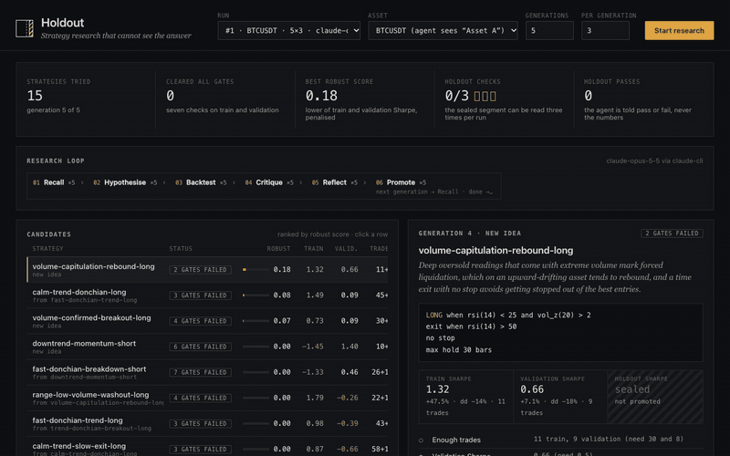
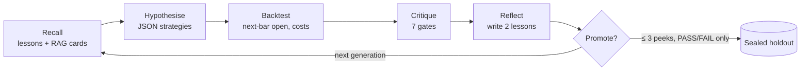

<div align="center">

# Holdout

**Strategy research that cannot see the answer.**<br>
An LLM quant agent with blind data, a sealed holdout it can only peek at three times, and a random-search control it has to beat.


[Demo](#demo) · [Features](#features-to-try) · [How it works](#how-it-works) · [Quick start](#quick-start) · [Tests](#tests)



</div>

---

## Why

Ask an LLM to "find a BTC strategy" and it will quietly lean on what it remembers about BTC's chart. Even honest
research drifts toward overfitting when you try enough ideas. Holdout is built to stop both:

| Failure mode | Holdout's countermeasure |
|---|---|
| The model remembers the asset | **Blind research:** the asset is "Asset A", with no dates, no prices, only distributional facts |
| The model writes code that cheats | **Closed JSON DSL:** 8 indicators, at most 3 entry and 2 exit conditions. It emits data, never code |
| Backtests peek at the future | **Next-bar-open fills** with fees and slippage. A property test proves no indicator uses later bars |
| Trying many ideas inflates Sharpe | **Deflated Sharpe gate:** the bar rises with every strategy tried |
| Tuning on the test set | **Sealed holdout:** last 20% of bars, **3 peeks per run**, answers are PASS or FAIL only |
| "Did the agent actually help?" | **Control arm:** random search over the same DSL, same gates, same budget, 8 seeds |

## Demo

<div align="center">

</div>

A full tour of a finished run: 15 strategies across 5 generations, the research loop, ranked candidates with
their gate results, the frontier against the random control, and the lessons the agent wrote for itself.

## Features to try

### 1. Click any candidate, read its thesis and every gate it failed


Each strategy shows its rule in plain language, train and validation Sharpe, a hatched **sealed** holdout cell,
and seven gate verdicts with the numbers behind each one (trade count, decay, parameter stability under ±15% jitter,
cross-asset breadth, drawdown, deflated Sharpe).

### 2. See the agent against a random-search control, and the memory it builds


The frontier chart draws the agent's best robust score by generation over the median, interquartile range and
best seed of 8 random-search runs. Below it, **lessons** the agent wrote (at most two per generation, each
falsifiable) with their learned utility, and the full event trace of the run.

In the first live run the agent's frontier reached **0.18** by generation 4 while the random median stayed at
**0.00** (best seed 0.03). The gates promoted nothing to the sealed holdout, which is the honest outcome for 15
trials on one asset.

## How it works



- **Self-improvement.** Lessons live in SQLite-backed memory. Retrieval ranks by lexical relevance × a
  Laplace-smoothed utility: the share of past recalls that preceded an improvement in the run's frontier. Memory
  persists across runs and assets.
- **RAG.** Four knowledge cards (overfitting, trend, mean reversion, volatility and costs) retrieved by hybrid
  BM25 + TF-IDF and cited in prompts.
- **Harness engineering.** The model proposes; validation and clamping in code decide what can run.
- **Data.** Binance public 4h klines (BTC, ETH, SOL), cached on disk so every backtest in a session sees identical
  bars. About 7,000 bars each, split 60 / 20 / 20.

## Quick start

```bash
python3 -m venv .venv && source .venv/bin/activate
pip install -r requirements.txt          # needs git access to cacheycat/agentkit
python app.py                            # http://localhost:8811
```

The LLM layer picks a provider automatically: `ANTHROPIC_API_KEY`, else a local `claude` CLI (headless, every tool
disabled), else the deterministic baseline policy, which is also what the control arm uses.

Working on both repos at once? Link a sibling checkout instead:

```bash
pip install fastapi uvicorn numpy certifi pydantic
ln -s ../agentkit/agentkit agentkit      # ignored by git
```

## API

| Method | Path | Purpose |
|---|---|---|
| GET | `/api/meta` | Assets, split dates, provider mode, memory stats |
| POST | `/api/research` | Start a research run (`asset`, `generations`, `per_gen`, `baseline`) |
| GET | `/api/equity` | Equity curve for a strategy on a segment |
| GET | `/api/memory` | Stored lessons with their learned utility |
| POST / GET | `/api/baseline` | Run / read the 8-seed random-search control |
| GET | `/api/runs`, `/api/runs/{id}`, `/api/runs/{id}/events` | Run list, detail, replayable SSE trace |

## Tests

```bash
pip install -r requirements-dev.txt
pytest -q && ruff check .
```

Includes a property check that every indicator value at bar `i` is unchanged when later bars are removed, and that
fills happen strictly after a signal bar.

## Part of a set

Built on [agentkit](https://github.com/cacheycat/agentkit), alongside
[casefile](https://github.com/cacheycat/casefile) (on-chain investigation) and
[undertow](https://github.com/cacheycat/undertow) (whale positioning desk).

> Research tooling, not investment advice.
